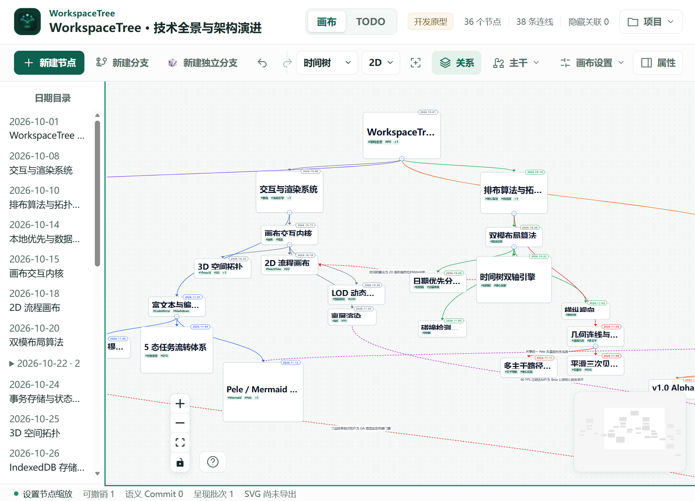

  

# WorkspaceTree

> [中文版](README_zh.md) | [Live demo](https://panwanke.github.io/workspacetree/)

WorkspaceTree is a browser-based, local-first topological workspace canvas for organizing projects as living trees of dated nodes. Explore dual-mode timelines, write Markdown with live preview, manage 5-state tasks, and gain holistic architectural visibility.

  

**Prototype:** This project is in active development and is not intended for production project data. Keep separate backups of anything you experiment with.

## Official Showcase & Architecture Philosophy (Art, Engineering & Philosophy)

WorkspaceTree is far more than a conventional mind map or task board; it embodies a dynamic equilibrium among **Artistic Rhythm**, **Engineering Rigor**, and **Philosophical Order**.

In our official interactive showcase project (**"WorkspaceTree · Technology Panorama & Architectural Evolution"**), we put this philosophy into full practice:

### 1. The Triadic Equilibrium

- **Engineering Rigor**: Deterministic pure-function layout algorithms (zero DOM dependencies), dual-axis (Timeline Tree + Date-First) geometric constraints, AABB collision avoidance, Local-First offline persistence, and microsecond-level hash isolation. Without engineering certainty, spatial aesthetics degrade into clutter.
- **Artistic Rhythm**: Rejecting the monotonous sterility of rigid grids, WorkspaceTree introduces **staggered visual pacing ("错落有致")**. By leveraging **Branch Scaling (`branchScales`)** to modulate subtree density and **Node Scaling (`nodeScales`)** to anchor tactical focus, combined with smooth cubic Bezier connections, restrained Callout alerts, and inline Pele / Mermaid flowcharts, the canvas breathes with life.
- **Philosophical Order**: The dialectic synthesis of macro architectural elevation and micro execution flow; the orthogonal harmony of chronological progression (Chronos) and structural hierarchy (Logos); disciplined divergence and deliberate convergence toward key release milestones.

### 2. Built-in Tree Aesthetics & Typographic Guide Node

The showcase includes a dedicated master guide node (**"Tree Layout Aesthetics & Philosophy Guide"**, ID: `n_layout_philosophy`), detailing:

- **Card Layout & Typography**: Anchoring visual gravity with headers, applying restrained Callouts (`[!IMPORTANT]`, `[!TIP]`, `[!NOTE]`, `[!WARNING]`) as breathing pauses (no more than 1–2 per card), 5-state task lifecycle (`[x]`, `[~]`, `[?]`, `[-]`, `[ ]`), and balanced diagram dimensions.
- **Branching Strategies**: The 3–5 primary pillar golden ratio, narrative spine navigation, specialized leaf divergence, and purposeful cross-branch relations (`dependency`, `reference`, `custom`).
- **Scale Mastery**: The three-tier scale formula (Strategic Anchor 1.15–1.25, Tactical Pillars & Accents 1.05–1.15, Standard Nodes 0.95–1.02, Auxiliary Modules 0.80–0.90), cascading branch scale fields, and negative space via collapsed summary capsules.

## Layouts

| View          | Description                                                                                 |
| ------------- | ------------------------------------------------------------------------------------------- |
| Time tree     | The default layout follows branches and permits up to seven days of positional flexibility. |
| Date priority | Arranges dated nodes in chronological bands while separating branches.                      |

Both views support horizontal and vertical layouts. Undated parent nodes are positioned using their dated descendants.

## Features

- Create, move, copy, cut, paste and collapse branches, including across project tabs.
- Real-time Markdown live editing & preview with CodeMirror 6, formatting shortcuts, Callouts and 5-state tasks (`[ ]`, `[x]`, `[-]`, `[~]`, `[?]`).
- Self-contained image embedding with SHA-256 deduplication, automatic Worker compression (1 MiB / 2048 px threshold) and drag-to-resize relative width (`{width=X%}`).
- Edit node dates, Markdown notes, tags, tasks, sizes and connections, with auto-save on blur and 5-second draft backup.
- Browse tasks by branch and locate nodes using the date directory.
- Switch between 2D and 3D, highlight paths and export SVG.
- Import and export .branch.json files. Ctrl+S or ⌘S downloads the current project.
- Store project snapshots locally in the browser using IndexedDB.
- Optional account sign-in (phone OTP / WorkBuddy account / WeChat QR) with per-account cloud projects; without cloud configuration the app stays fully local.

## Dual Deployment & Account System

WorkspaceTree maintains a strict architectural separation between two deployment models:

| Variant            | Target Environment                            | Build Command & Entry                                                                                         | Accounts & Storage                                        | Isolation Mechanism                                                                                                                        |
| ------------------ | --------------------------------------------- | ------------------------------------------------------------------------------------------------------------- | --------------------------------------------------------- | ------------------------------------------------------------------------------------------------------------------------------------------ |
| **Static Offline** | GitHub Pages & static hosting                 | `pnpm --filter @workspacetree/web build:static` Entry: `static/main.tsx` Output: `dist-static/`         | No sign-in Browser IndexedDB or direct local file sync | **Physical Isolation**: Build plugins strictly forbid and reject all cloud SDKs and authentication modules. Zero remote auth dependencies. |
| **Cloud Account**  | Server / Cloud hosting (e.g. WorkBuddy Cloud) | `pnpm --filter @workspacetree/web build` Entry: `src/main.tsx` Output: `dist/` (packaged as `release/`) | Phone / OAuth / WeChat Cloud DB (RLS) + Local fallback | **Server-side RLS**: Row-Level Security (`auth.uid()`) guarantees tenant isolation. The frontend never passes `owner_id` directly.         |

### Local Development & Testing Notes

In the static edition on desktop Chrome or Edge, choose **Project → Open and sync .branch.json** and grant read and write access. Saved edits go straight to the original file. The page checks for disk changes while it is in the foreground and waits for you to exit an open editor before applying an external change. If the browser revokes file access, use the same menu item to reopen it. Import and drag-and-drop still open a browser copy.

- **Why does local `pnpm dev` display the account login?**  
  Running `pnpm dev` defaults to the full-featured root entry (`apps/web/index.html` → `src/main.tsx`, the **Cloud Account** variant). When public development configuration parameters are present, the account service panel is enabled. If left unconfigured, it gracefully falls back to local guest mode.
- **How to test the static offline build locally?**  
  Run `pnpm --filter @workspacetree/web smoke:static` to preview the exact static offline bundle using `vite.static.config.ts`.

### Enabling Cloud Accounts

1. Activate your cloud service and supply public client configuration (`endpoint`, `oauthRelayBaseUrl`, `publishableKey`) in `apps/web/src/cloud/public-config.ts` (_Security notice: never commit sensitive server secrets to public repos_).
2. Execute [`docs/cloud-schema.sql`](docs/cloud-schema.sql) in your cloud SQL editor to initialize `public.workspacetree_projects` with row-level security. The client never sends `owner_id`; RLS derives it from `auth.uid()`.
3. Build with `pnpm --filter @workspacetree/web build` and deploy to your authorized HTTPS origin.
4. Verify sign-in, project save/load, and permission boundaries. OAuth callbacks must land on the site root within the same browser tab, where PKCE state is maintained in `sessionStorage`.

Signed-in users get an account-scoped project store and separate tab-session keys. Signing in or out reloads the page because every `EditorController` holds a storage reference; an external sign-out from another tab also triggers this reload. Existing local projects are **not** migrated automatically — export and re-import `.branch.json` to move them into an account.

## Quick start

Visit the [live demo](https://panwanke.github.io/workspacetree/) or run locally with Node.js 22.12 or newer and pnpm 10.33.0:

    corepack enable
    pnpm install --frozen-lockfile
    pnpm dev

Open the local URL printed by Vite. Use **Project → Import .branch.json** or drag a file into the application. Use **Project → Export .branch.json** or Ctrl+S to download a snapshot.

## Development

    pnpm typecheck
    pnpm lint
    pnpm test
    pnpm --filter @workspacetree/web build

See the [change index](CHANGELOG.md).

## Technology

React, TypeScript, Vite, React Flow, Three.js, Zod, pnpm workspaces, IndexedDB and the WorkBuddy Cloud SDK (Auth + Database with row-level security).

## License

No open-source license has been specified for this repository.
