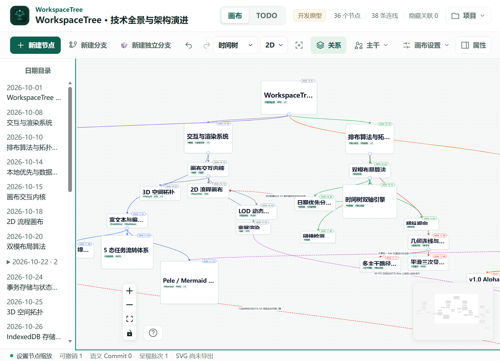

  

# WorkspaceTree

> [English](README.md) | [在线演示](https://panwanke.github.io/workspacetree/)

WorkspaceTree 是一个基于浏览器的本地优先（Local-First）拓扑工作区画布，以树状拓扑组织工作，结合时间主轴查看分支、编辑任务、沉浸书写 Markdown 并进行复杂架构演进透视。

  

**开发原型：** 项目仍在开发中，不能用于承载正式项目数据。试用时请另行保留备份。

## 官方演示项目与构建美学：艺术、工程与哲学的平衡

WorkspaceTree 不只是一个简单的脑图绘制或任务看板工具，更是一套追求**艺术的韵律**、**工程的坚实**与**哲学的秩序**动态平衡的拓扑认知空间。

在官方交互演示项目（**「WorkspaceTree · 技术全景与架构演进」**）中，我们全方位实践并展示了这一平衡思路：

### 1. 三位一体的平衡哲学

- **工程之骨（Engineering Rigor）**：纯函数确定性排布（0 DOM 依赖）、双轴（时间轴 + 树层级）几何约束、AABB 碰撞检测与避障、Local-First 离线持久化与微秒级哈希隔离。没有工程的绝对确定性，拓扑美学就会沦为失控的杂乱。
- **艺术之韵（Artistic Rhythm）**：拒绝均质网格的机械冰冷，引入**错落有致（Staggered Pacing）**。通过**分支缩放（Branch Scale）**调节子树信息密度场，通过**节点缩放（Node Scale）**锚定关键战术焦点；配合平滑三次贝塞尔曲线、优雅的 Callout 留白与行内 Pele/Mermaid 矢量流程图，让工作区拥有如交响乐般的呼吸感。
- **哲学之序（Philosophical Order）**：宏观透视（Macro Overview）与微观沉浸（Micro Immersion）的辩证统一；时间演进（Chronos）与逻辑分流（Logos）的正交展开；克制分叉、及时收敛，化解信息熵增与任务碎片化。

### 2. 树状排布美学与构建指导（内置核心指南节点）

演示项目中特别内置了 **「排布美学与构建哲学指南」** 核心节点（ID: `n_layout_philosophy`），提供系统性实践指导：

- **卡片排版法则（Card Layout）**：标题视觉重心锚定、Callout 告警框（`[!IMPORTANT]` / `[!TIP]` / `[!NOTE]` / `[!WARNING]`）克制留白（一张卡片不超过 1~2 个）、5 态任务体系（`[x]` / `[~]` / `[?]` / `[-]` / `[ ]`）动态流转、行内矢量图元尺度平衡。
- **分支规划与演进策略（Branching Strategy）**：3~5 根一级核心支柱的黄金发散度、主干（Spines）的叙事贯穿与专注聚焦、侧枝的专业延展、跨分支关联边（`dependency` / `reference` / `custom`）的精准联络。
- **分支与节点缩放实操（Scale Mastery）**：三级层次缩放律（战略核心 1.15~1.25、战术支柱与高亮重音 1.05~1.15、标准流转 0.95~1.02、细节与背景支撑 0.80~0.90）、分支缩放的级联场效应与虚实相生的折叠胶囊（Negative Space & Collapsing）。

## 布局方式

| 视图     | 说明                                                         |
| -------- | ------------------------------------------------------------ |
| 时间树   | 默认布局，结合分支结构与日期，允许节点在七天范围内调整位置。 |
| 日期优先 | 按日期分层排列节点，同时为不同分支留出空间。                 |

两种视图均支持横向和纵向排布。没有日期的母节点根据后代日期确定自动位置。

## 功能

- 创建、移动、复制、剪切、粘贴和折叠分支，支持跨项目标签页操作。
- 基于 CodeMirror 6 的 Markdown 实时编辑与预览，支持快捷键格式化、Callout 提示框与 5 态任务体系（`[ ]`、`[x]`、`[-]`、`[~]`、`[?]`）。
- 项目自包含图片嵌入、SHA-256 去重、Worker 自动压缩（超 1 MiB / 2048 px 触发）与拖拽相对宽度缩放（`{width=X%}`）。
- 编辑节点日期、Markdown 笔记、标签、任务、尺寸和连线，支持失焦/离开节点与 5 秒定时自动保存。
- 按分支汇总任务，通过日期目录定位节点。
- 切换 2D 与 3D 视图，高亮主干并导出 SVG。
- 导入和导出 .branch.json，按 Ctrl+S / ⌘S 下载当前项目文件。
- 使用浏览器 IndexedDB 本地保存项目快照。
- 可选的账号登录（手机号验证码 / WorkBuddy 账号 / 微信扫码）与按账号隔离的云端项目空间；未配置云服务时完全保持本地模式。

## 双部署方案与账号体系

WorkspaceTree 采用严格分流的**双部署方案**，在代码和构建层实现物理隔离：

| 方案             | 部署目标                         | 构建入口与产物                                                                                         | 账号与存储                                         | 核心特征与隔离机制                                                                                                           |
| ---------------- | -------------------------------- | ------------------------------------------------------------------------------------------------------ | -------------------------------------------------- | ---------------------------------------------------------------------------------------------------------------------------- |
| **纯静态单机版** | GitHub Pages 等静态托管          | `pnpm --filter @workspacetree/web build:static` 入口：`static/main.tsx` 产物：`dist-static/`     | 无账号登录 浏览器 IndexedDB 本地保存            | **物理隔离**：构建时通过专用插件拦截并禁止引入任何云端 SDK 与登录逻辑，不产生任何远程鉴权依赖，完全离线单机运行。            |
| **云端账号版**   | 云托管服务（如 WorkBuddy Cloud） | `pnpm --filter @workspacetree/web build` 入口：`src/main.tsx` 产物：`dist/`（发布为 `release/`） | 支持账号登录 云端数据库（按账号隔离）+ 本地备用 | **服务端 RLS 隔离**：接入云端 BaaS 与数据库，支持手机号/微信/OAuth 登录；数据行通过服务端 RLS 强隔离，前端绝不发送用户凭证。 |

### 本地开发与测试说明

- **为什么本地运行 `pnpm dev` 可以看到账号登录？**  
  日常开发执行 `pnpm dev` 时，默认加载的是全功能开发入口（`apps/web/index.html` → `src/main.tsx`，即**云端账号版**）。若本地已注入对应的测试公开配置，应用就会激活账号服务面板；若配置为空，则会自动优雅降级为本地游客模式。
- **如何在本地预览与测试纯静态版（GitHub Pages 镜像）？**  
  执行 `pnpm --filter @workspacetree/web smoke:static`，即可通过独立的静态配置文件（`vite.static.config.ts`）在本地启动与 GitHub Pages 完全一致的无账号纯单机测试环境。

### 在云端部署中启用账号

1. 为应用激活对应云服务，将分配的公开参数（`endpoint`、`oauthRelayBaseUrl`、`publishableKey`）配置到 `apps/web/src/cloud/public-config.ts`（**安全提示**：请勿将生产环境敏感密钥提交到公开仓库）。
2. 在云端 SQL 编辑器中执行 [`docs/cloud-schema.sql`](docs/cloud-schema.sql)，创建 `public.workspacetree_projects` 表与 RLS 策略。前端从不发送 `owner_id`，由服务端的 `auth.uid()` 自动填充并按账号隔离。
3. 执行 `pnpm --filter @workspacetree/web build` 构建后，部署至授权的 HTTPS 域名。
4. 部署后验证登录、云端项目读写以及未授权拦截路径。OAuth 回调需落在站点根路径并在同一标签页完成，WorkBuddy 登录的 PKCE 证明存在该标签页的 `sessionStorage`。

登录后使用账号项目空间与独立的标签页会话 key；由于 `EditorController` 持有 storage 引用，登录 / 登出会重载页面以重建控制器，其他标签页登出同样会触发重载。本地已有项目**不会自动迁移**，用户可随时通过导出并在登录后重新导入 `.branch.json` 将项目同步到账号中。

## 快速开始

打开[在线演示](https://panwanke.github.io/workspacetree/)，或安装 Node.js 22.12 及以上版本和 pnpm 10.33.0，在本地运行：

    corepack enable
    pnpm install --frozen-lockfile
    pnpm dev

在浏览器打开 Vite 显示的地址。通过「项目 → 导入 .branch.json」或拖入文件打开项目，通过「项目 → 导出 .branch.json」或 Ctrl+S 下载项目快照。

## 开发

    pnpm typecheck
    pnpm lint
    pnpm test
    pnpm --filter @workspacetree/web build

更多信息见[变更索引](CHANGELOG.md)。

## 技术栈

React、TypeScript、Vite、React Flow、Three.js、Zod、pnpm workspaces、IndexedDB 与 WorkBuddy Cloud SDK（Auth + Database，数据库 RLS 隔离）。

## 许可证

本仓库尚未指定开源许可证。
